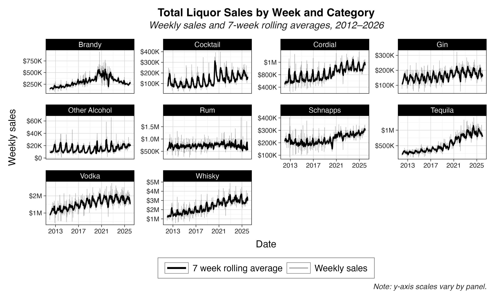
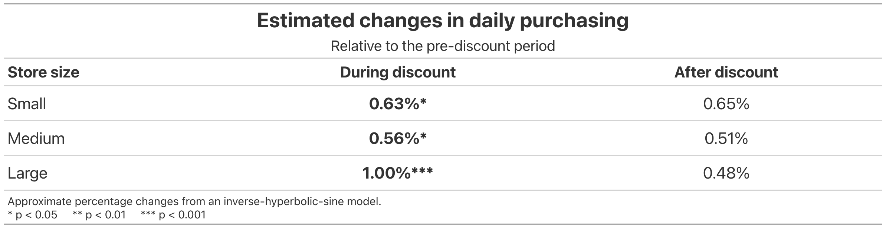

## Project Overview

This repo contains an overview of econometric research I conducted during the summer of 2026 with Wesleyan professor Pavel Oleinikov. Our goal was to discover the effect of temporary liquor discounts on retail demand, explore the effect of seasonality on purchasing patterns, and observe if stores used discounts as an opportunity to stockpile inventory.

## Plots





## Features

-   Cleaned and standardized over 34 million Iowa liquor transaction for analysis
-   Built SQL script to identify and characterize temporary product discount episodes
-   Built store-product-date and daily sales panels for econometric analysis
-   Constructed event-time variables to measure purchasing behavior before, during, and after discounts
-   Estimated fixed-effects regression models to measure the relationship between discounts and demand

## Tools

-   Fixed-effects econometric modeling

-   Data cleaning & panel construction

-   Data visualization / ggplot2

-   R

-   SQL / Google BigQuery

## Data

Transaction data comes from the publicly available [Iowa Liquor Sales Dataset](https://data.iowa.gov/catalog/dataset/1051). Iowa acts as a modified control state, meaning the state's Alcoholic Beverages Division (ABD) is the sole seller of liquor products to liquor stores in Iowa. This dataset is a complete log of all transactions starting from January 2012 between the ABD and Iowa liquor retailers.

## Other Project Resources

-   [Full Report](docs/full_report.md)
-   [Scripts and Methodology](docs/script_methodologies.md) *(detailed descriptions of scripts and methodology)*
-   [Poster](figures/poster.png) *(presented at Wesleyan University's Summer Science Symposium)*

## Repository Structure

```         
.
├── README.md
├── scripts/                       # SQL panel-building and analysis scripts
│   ├── discount_timing_event_stud_panel.sql
│   ├── discount_detection.sql
│   ├── daily_sales_panel.sql
│   └── build_panel_w_zero_rows.sql
├── script_methodologies/          # Methodology notes for each script
│   ├── temp_price_red.md
│   ├── simplifying_alcohol_categories.md
│   ├── daily_sales_panel.md
│   └── constructing_store_product_date_panel.md
├── figures/                       # Generated plots, charts, and exported data
├── docs/                          # Write-ups and reports
│   ├── script_methodologies.md
│   └── full_report.md
```

## Acknowledgments

This research was completed through Wesleyan University’s Quantitative Analysis Center Apprenticeship under the supervision of Professor Pavel Oleinikov.
