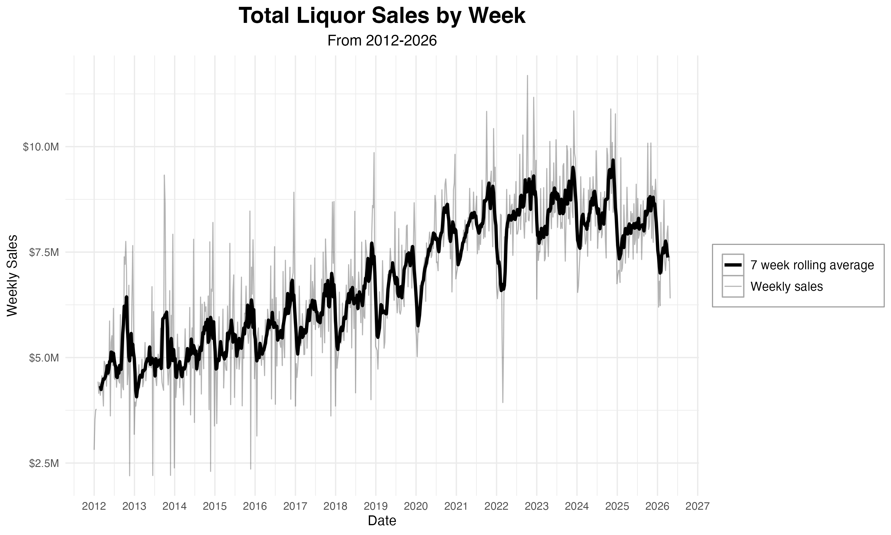
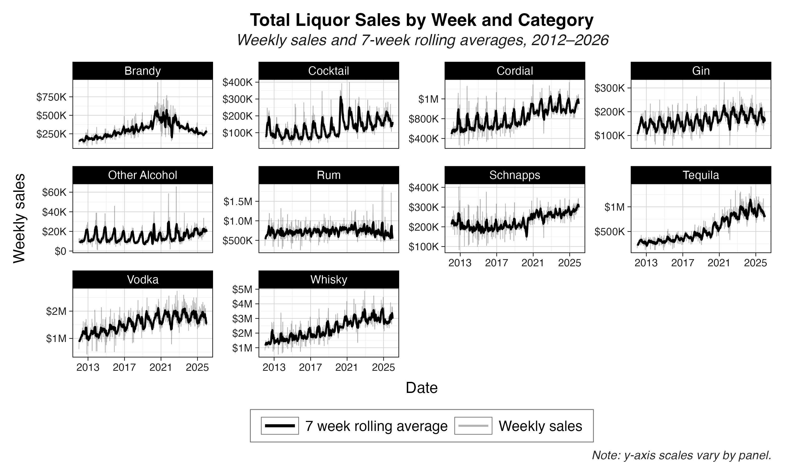
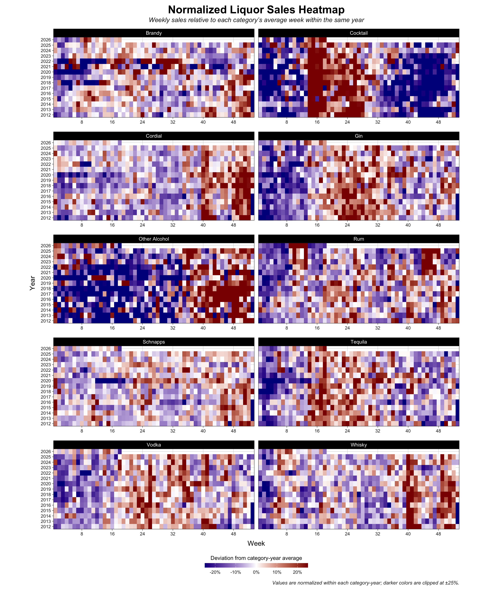
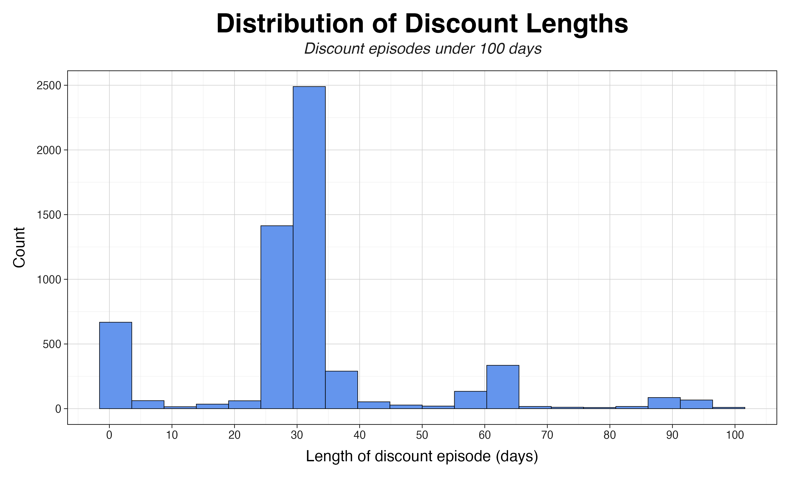
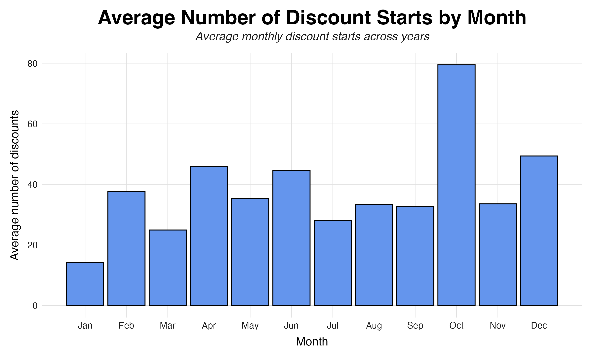
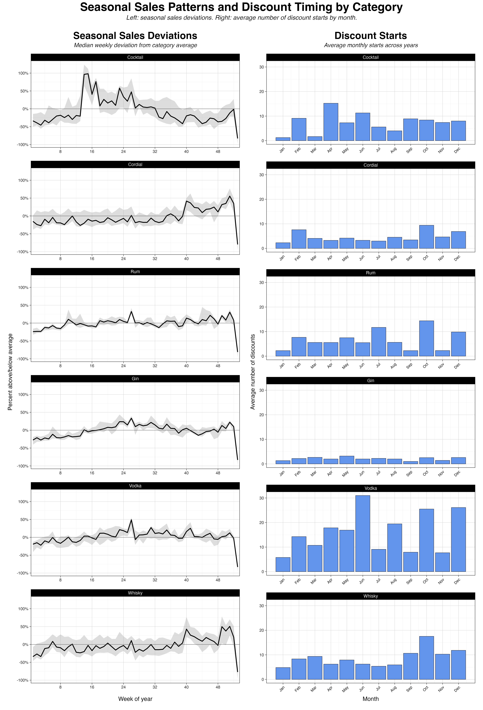
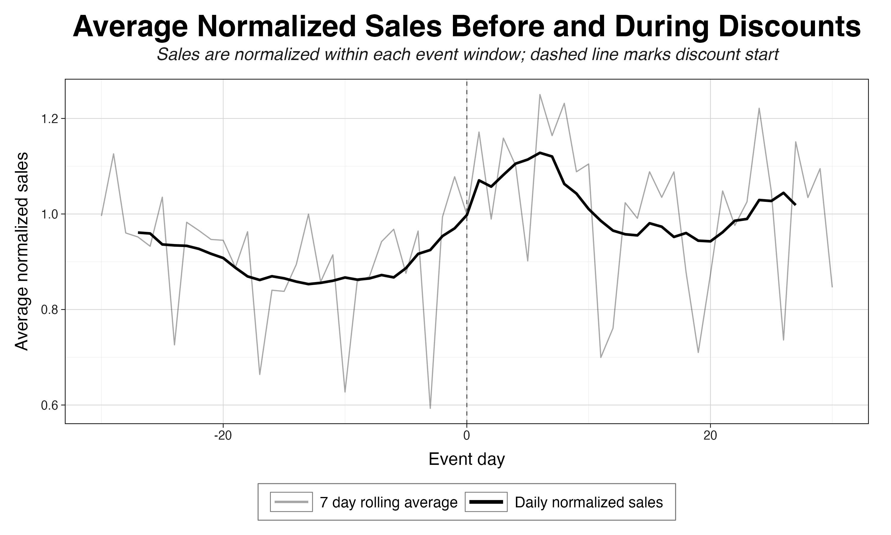
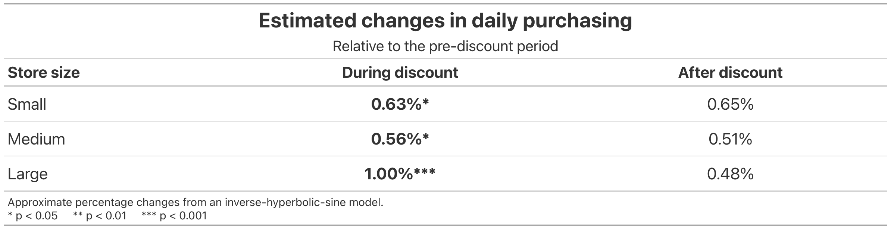

## Full Report

This markdown expands on the overview given in the [project README](../README.md), and is a more complete picture of the research I conducted summer 2026 with Pavel Oleinikov and the Wesleyan Quantitative Analysis Center.

#### Research Questions

My work this summer focused on four main questions:

-   How do seasonal purchasing patterns affect the interpretation of discount-related changes?
-   Do retailers increase their purchases during temporary wholesale discounts?
-   Do purchases decrease after a discount ends, suggesting stockpiled inventory?
-   Does the response to discounts differ between small, medium, and large stores?

#### The Data

Iowa operates as a wholesale-only control state, meaning the state acts as the sole seller for retail liquor purchases. The Iowa Alcoholic Beverages Division distributes liquor to retailers from a single central warehouse, sets uniform bottle prices across the state, and records all retail transaction data in the publicly available [Iowa Liquor Sales dataset](https://data.iowa.gov/catalog/dataset/1051).

The [Iowa liquor sales dataset](https://data.iowa.gov/catalog/dataset/1051) contains the complete transaction history of all Iowa liquor store spirit purchases since 2012. It contains 34.6 million observations across 23 variables. It includes invoice IDs, purchase dates, store details, vendor names, item descriptions, bottle volumes, costs, retail prices, and total sales dollars for each transaction.

#### Scripts

A complete log of scripts and a description of methods are available in:

[`docs/scripts_methods.md`](../docs/scripts_methods.md)

This includes the scripts and methodology used to clean transaction data, detect temporary price discounts, and build panels for analysis.

## Results

Below is a complete chronological report of the work I completed this summer.

### Exploratory Analysis

We knew seasonality would play a role in discounts. Here's the exploratory analysis of seasonality and how that affected our decisions.

#### Seasonality

First we started by viewing total liquor sales by week.

We see a clear indication of a seasonal pattern, with regular rising and falling of the 7 week rolling average. Additionally, we see an increase in demand following the onset of the Covid-19 pandemic, peaking in 2024 and since falling back towards normal levels.

We faceted by liquor category, allowing us to view individual liquor trends. The graphs for cocktails and cordials have more distinct spikes, indicating stronger seasonal trends.

Whisky, Tequila, Cordials, and Vodka all saw consistent, upward, long-term growth. Brandy had a pronounced increase during, and decline after, the pandemic. The other categories appear to be slowing down toward relative pre-pandemic levels.

This plot gives us further insight into some of the trends viewed in figure 2.

As we can see, cocktails consistently see high sales from late March to early July, likely because liquor stores are stocking up for summer.

Tequila also consistently has high sales in late spring.

Gin also consistently has higher sales during the summer.

Vodka experiences a spike in June.

Whisky has two characteristic spikes every winter, likely corresponding to Thanksgiving and the winter holidays.

Knowing these seasonal sales patterns is important: if discounts are placed before periods of high demand, the effect of a discount could be overstated. Conversely, if discounts are placed before periods of low demand, their effect could be understated. We explore the placement of discounts in the next section.

#### Discount Analysis

First, we notice that the vast majority of observed discounts are about a month long, with the next most common length being between 1 and 3 days. We also see a smaller group of discounts around the 2 month mark, and an even smaller group around 3 months.

Next we looked at the average number of discounts throughout the year. Here we see the most discounts starting in October and December, followed by April, June, and February.

Here we see our first evidence of strategic timing: October and December are both close to high-demand holiday periods, while April and June line up with the rise into warmer-weather sales and summer purchasing. This is important because the response to a discount is endogenously affected by its timing.

When comparing average discount placement to average sales, we see that some categories' discounts tend to show strong overlap with periods of high demand, other categories' discounts tend to overlap with periods of low demand, and some appear placed seemingly at random. There is also a lot of variety from category to category.

Here we see the average pattern of sales around discount placements. The chart shows that, in general, demand tends to be below average for the period before the start of a discount, and rises immediately following the start of a discount. It is unclear from this chart whether this pattern comes from stores shifting purchasing patterns to align with discounts, from vendors placing discounts during periods of high demand, or from some combination of other factors. Because of this, we included product, date, and store size fixed effects in our regression to isolate these factors.

This is strong evidence that discount placement is strategic, and it makes clear that a date fixed effect is needed in the regression — further evidence of endogeneity in discount placement.

### Regression Analysis

The regression analysis examines how temporary price reductions affect the number of bottles purchased while accounting for differences across products, stores, and time. We first constructed a daily store-product panel and identified temporary discount episodes. To reduce overlap between promotions, we only included discounts that were not preceded or followed by another discount within 30 days. We also restricted the sample to 524 stores whose store IDs consistently mapped to a single location and owner.

For each discount episode, we compared purchases before, during, and after the discount. The resulting data were organized as a stacked store-product-discount-episode-date panel, allowing each qualifying discount to be treated as a separate event. We used the inverse hyperbolic sine transformation of bottles purchased to account for the highly skewed distribution of sales while retaining observations with zero purchases.

We estimated a fixed-effects regression with separate indicators for the discount and post-discount periods. Store-product-episode fixed effects account for characteristics that are constant within each event, while date fixed effects control for common changes over time, including seasonality and calendar effects. We estimated the effects separately for small, medium, and large stores to examine whether purchasing responses differed by store size.

Purchasing increased modestly during discounts across all store sizes, with the largest increase among Large stores. Post-discount purchasing did not significantly differ from the pre-discount baseline.

Our regression examines the changes across store purchasing patterns for every product they have ever purchased, across every discount for that product. Next steps could include designing models to see if stores stockpile specific products or stockpile around specific dates.
