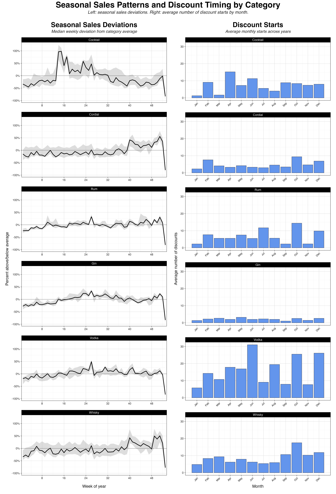
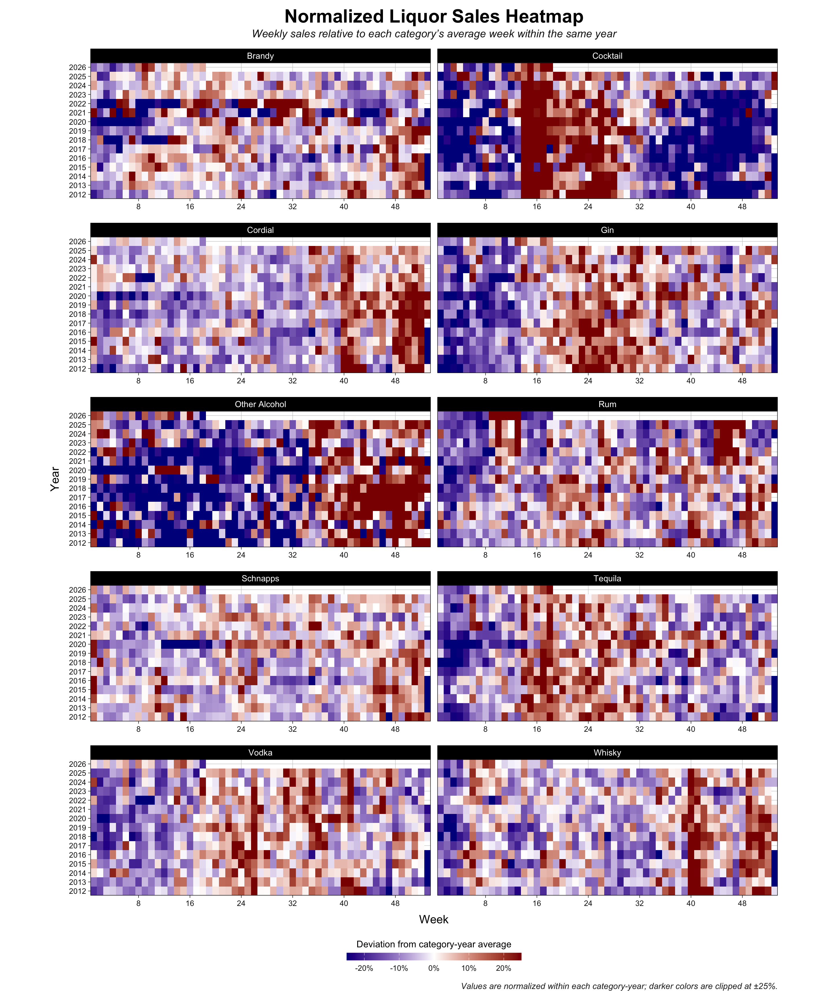
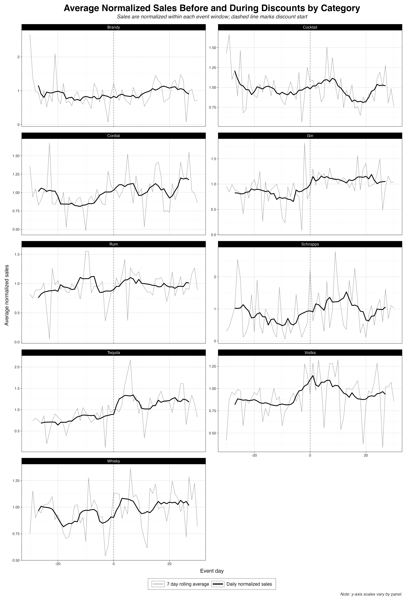

# Constructing Daily Product Sales Panel

### Background

In order to explore seasonal purchasing patterns, discount placement, and the effect of discounts on purchasing behavior, I used our transaction data to create an aggregated daily sales panel. This allowed us to create visualizations, descriptive plots, and conduct exploratory analyses.

### [Script](../scripts/daily_sales_panel.sql)

```{sql}
create or replace table ild.daily_sales_panel as

with cte as (

  with collapsed as (
    select
      date,
      item_desc_updated,
      vendor_name_updated,
      bottle_volume_ml,
      category_simple,
      any_value(state_bottle_retail_upd) as state_bottle_retail_upd,
      --deterministic, iowa law requires retail price to be the same each day to all stores across all transactions.
      round(sum(sale_dollars_upd), 2) as total_sale_day,
      -- sum total sales across each product
      count(*) as n_transactions_day,
      sum(bottles_sold) as n_bottles_sold_day,
      pack,
      item_number_updated

    from ild.simp_map_error_rem as main

    group by
      -- grouped by date and product identifiers
      -- unique products are identified by item_number, pack, and bottle volume ml.
      -- Other groupings (item_desc, vendor name, category_simple)
      -- are deterministic given the product identifiers above.
      date,
      item_desc_updated,
      item_number_updated,
      vendor_name_updated,
      bottle_volume_ml,
      category_simple,
      pack
  )

  -- Join to temp_price_red_ep to flag rows in a discount window and compute
  -- the discount amount (percentage and absolute dollars) for those rows.
  -- pre_drop_date/episode_end_date are exclusive endpoints by design.
  select
    case when episode.item_number_updated is not null then 1 else 0 end as in_discount_window,
    round(episode.reference_price - main.state_bottle_retail_upd, 2) as discount_amount_abs,
    round(100 * ((episode.reference_price - main.state_bottle_retail_upd) / episode.reference_price), 2) as discount_amount_percent,
    main.*

  from collapsed as main
  left join `ild.temp_price_red_ep` as episode
    on main.item_number_updated = episode.item_number_updated
    and main.pack = episode.pack
    and main.bottle_volume_ml = episode.bottle_volume_ml
    and main.date > episode.pre_drop_date
    and main.date < episode.episode_end_date

  order by date, vendor_name_updated, item_desc_updated, pack, bottle_volume_ml, item_number_updated
)

select * from cte
```

The table aggregates transaction data to a date x product panel, where a product is uniquely defined by `item_number_updated`, `pack`, and `bottle_volume_ml`.

The `collapsed` CTE sums total sales and transaction volume for each product on each date.

The outer query joins `collapsed` with the `temp_price_red_ep` to flag rows that fall inside a temporary discount window, and to compute the discount size for those rows.

A row is considered "in window" when its date falls strictly between `pre_drop_date` (the last date observed *before* the discount started) and `episode_end_date` (the first date on which the discount is observed to have ended).

For rows outside a discount window, `discount_amount_abs` and `discount_amount_percent` are `null`. See [`temp_price_red_ep.md`](temp_price_red.md) for how discount episodes and `reference_price` are defined.

### Example Plots

Below are some of the plots I created using this panel data. All plots are available in the [`/figures`](../figures) directory






