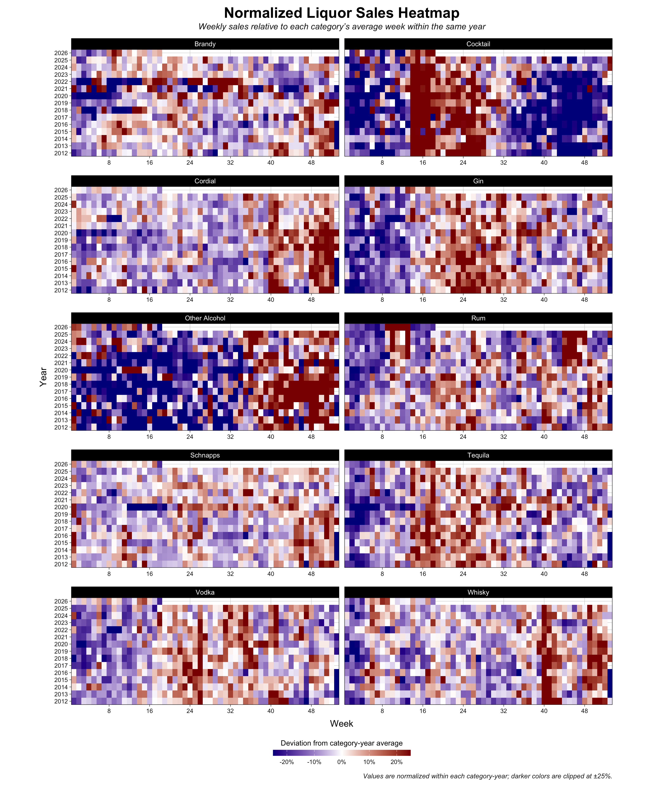
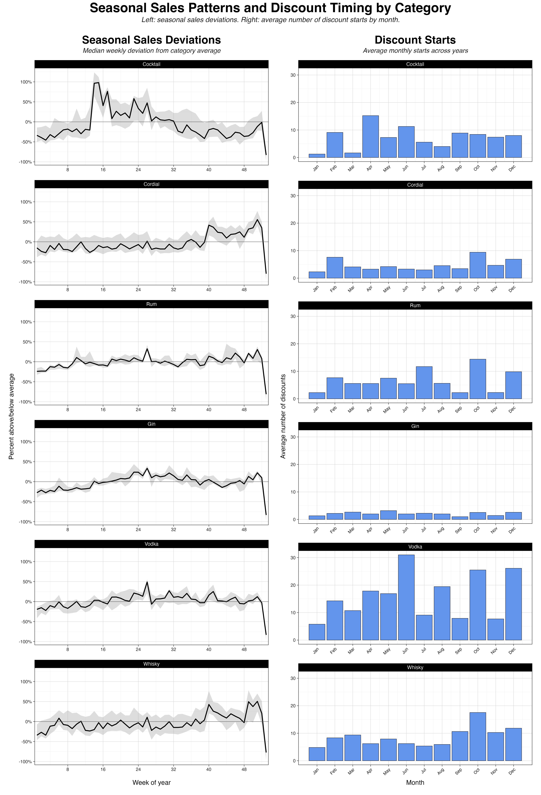
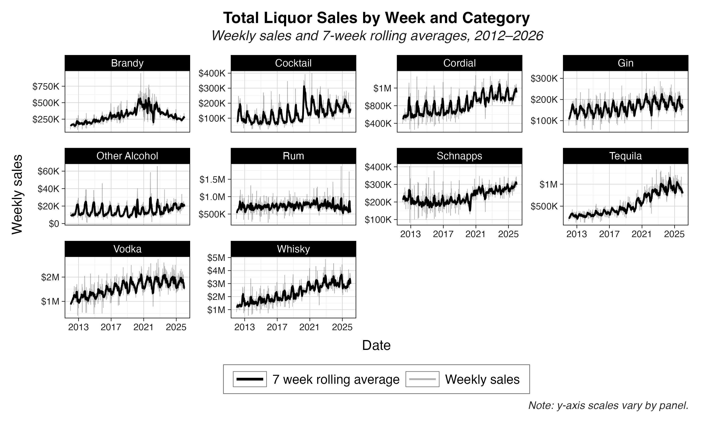

# Simplifying Alcohol Categories

### Problem

The source variable `category_name` contained 104 detailed categories. Several distinctions were more granular than the research required. For example, imported vodka, flavored vodka, and 100-proof vodka were separate source categories even though each belonged to the same broad product family for the planned analysis.

Some products also had a missing category. A single product could appear with a missing category in one transaction and a valid category in another, so treating every missing value as an unknown product would have discarded information already present elsewhere in the data.

### Target classification

I created `category_simple` with the following 10 mutually exclusive categories:

-   Brandy
-   Cocktail
-   Cordial
-   Gin
-   Other Alcohol
-   Rum
-   Schnapps
-   Tequila
-   Vodka
-   Whisky

### Step 1: Recover missing source categories

There were 552 items associated with a null `category_name`. I matched these items back to other transactions with the same `item_number` and a non-null category. Candidate categories were ranked by the number of rows in which they appeared.

This recovered a source category for 448 of the 552 items. The remaining items required classification from other product information.

``` sql
with missing_categories as (
  select distinct
    item_number,
    item_description
  from source_transactions
  where category_name is null
),
observed_categories as (
  select
    item_number,
    category_name,
    count(*) as n_rows_with_name
  from source_transactions
  where category_name is not null
  group by item_number, category_name
)
select
  m.item_number,
  m.item_description,
  o.category_name,
  o.n_rows_with_name
from missing_categories as m
left join observed_categories as o
  on m.item_number = o.item_number;
```

### Step 2: Apply a deterministic category crosswalk

Source categories that mapped cleanly to one broad family were assigned through a crosswalk. For example:

| Source category      | `category_simple` |
|----------------------|-------------------|
| `AMERICAN VODKAS`    | Vodka             |
| `IMPORTED VODKAS`    | Vodka             |
| `TENNESSEE WHISKIES` | Whisky            |
| `SPICED RUM`         | Rum               |
| `100% AGAVE TEQUILA` | Tequila           |

This rule was appropriate only when all products in a detailed source category belonged to the same broader category.

### Step 3: Classify non-homogeneous and unresolved categories

Some source categories, such as `IMPORTED DISTILLED SPIRITS SPECIALTY`, contained products from more than one broad family. Those categories could not be mapped safely with a category-level rule. The same was true for products whose source category remained missing.

We used an LLM as a first pass classifier to assign the remaining 3,501 items to our 10 broader categories. For each item, we included the product name, the vendor, and the source category (when available). The prompt instructed the model to assign each item to one of our 10 categories, including a detailed description of the types of products which belonged to our "other alcohol" category. We also instructed the model to flag ambiguous cases for manual review, and I manually classified the flagged 200 items. We also reviewed the remaining 3,301 LLM-assigned classifications for obvious errors or implausible category assignments.

### Outcome

By reducing the number of alcohol categories from 104 to 10, we were able to conduct meaningful analyses by alcohol categories. Some example plots are shown below.






