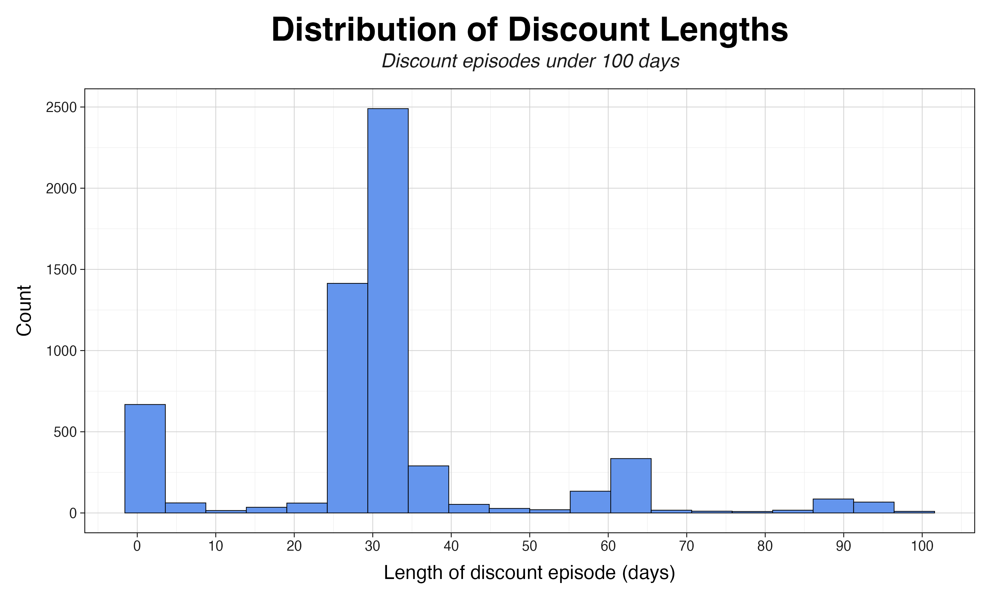

# Identifying Temporary Price Reductions

### Background

Our research aimed to explore the effect of temporary price reductions on wholesale liquor purchasing while accounting for seasonality.

Defining and identifying temporary price reductions was an important step in our research. By recording and collecting these temporary discounts, we could observe when and how often vendors discounted products, and if/how stores changed purchasing behavior.

### Definition

We defined temporary price reductions for a product as follows:

A [temporary price reduction for a product]{.underline} begins when the price of the product drops, and ends when it returns to (or above) the price observed before the initial drop. A product must return to (or above) its initial price before the drop in order to qualify as a temporary discount.

Note that successive discounts on a product (eg. \$10-\>\$8-\>\$7-\>\$11) and partial recoveries (eg. \$10-\>\$8-\>\$9-\>\$10) are considered to be one discount episode. Because of this, our definition does not allow for nested discount episodes.

### [Script](../scripts/discount_detection.sql)

```{sql}
create or replace table `iowa-liquor-sales-498314.ild.temp_price_red_ep` as

with a as (
  --group and collapse product / date info
  select
    date,
    --item number, bottle volume, and pack are a unique product identifier
    item_number_updated,
    bottle_volume_ml,
    pack,
    --item description, category, and product prices are the same across 
    --each date and product identifier
    any_value(item_desc_updated) as item_desc_updated, 
    any_value(category_simple) as category_simple,
    any_value(state_bottle_cost) as state_bottle_cost,
    any_value(state_bottle_retail_upd) as state_bottle_retail_upd
  from `ild.simp_map_error_rem`
  group by item_number_updated, bottle_volume_ml, pack, date
),

b as (
  -- capture the next observed price
  select
    a.*,
    lead(a.state_bottle_retail_upd, 1) over (
      partition by item_number_updated, bottle_volume_ml, pack
      order by date asc
    ) as next_observed_price
  from a
),

c as (
  --capture candidate_price_drop_start and reference_price_candidate
  --candidate_price_drop_start is an indicator variable that take 1 everytime next price < current
  --reference_price_candidate takes the price of the item right before it drops
  select
    b.*,
    case
      when next_observed_price < state_bottle_retail_upd then 1
      else 0
    end as candidate_price_drop_start,
    case
      when next_observed_price < state_bottle_retail_upd then b.state_bottle_retail_upd
      else null
    end as reference_price_candidate
  from b
),

d as (
  --find first future date where product goes back up to
  --(or above) the price before sale.
  select
    min(future.date) as candidate_recovery,
    c.*
  from c
  left join a as future
    on c.item_number_updated = future.item_number_updated
    and c.bottle_volume_ml = future.bottle_volume_ml
    and c.pack = future.pack
    and future.date > c.date
    and future.state_bottle_retail_upd >= c.reference_price_candidate
  where candidate_price_drop_start = 1
  group by all
),

e as (
  -- here we merge all candidate price drop start dates which occur before
  -- a given price drop start, with earlier episodes which have not recovered before
  -- the current candidate_pride_drop started
  -- we also count the number of earlier price drop episodes a price drop start
  -- is contained within for a given item-bottle-pack
  select
    cur.*,
    count(earlier.date) as n_earlier_containing_episodes
  from d as cur
  left join d as earlier
    on cur.item_number_updated = earlier.item_number_updated
    and cur.bottle_volume_ml = earlier.bottle_volume_ml
    and cur.pack = earlier.pack
    and earlier.date < cur.date
    and cur.date < earlier.candidate_recovery
  group by all
),

f as (
  select
    e.*,
    case
      when e.n_earlier_containing_episodes = 0 and candidate_recovery is not null then 1
      else 0
    end as true_price_drop_episode_start
  from e
),

g as (
  --create an epsiode id that counts the # of discounts per item-bottle-pack
  select
    sum(f.true_price_drop_episode_start) over (
      partition by item_number_updated, bottle_volume_ml, pack
      order by date
      rows between unbounded preceding and current row
    ) as episode_id,
    f.item_number_updated,
    f.date as pre_drop_date,
    f.candidate_recovery as episode_end_date,
    f.bottle_volume_ml,
    f.pack,
    f.reference_price_candidate as reference_price,
    f.item_desc_updated,
    f.category_simple
  from f
  where f.true_price_drop_episode_start = 1
),

h as (
  select
    g.item_number_updated,
    g.item_desc_updated,
    g.pre_drop_date,
    min(a.date) as sale_start_date,
    g.episode_end_date,
    date_diff(g.episode_end_date, min(a.date), day) as length_of_discount_days,
    g.category_simple,
    g.bottle_volume_ml,
    g.pack,
    g.episode_id,
    g.reference_price,
    min(a.state_bottle_retail_upd) as min_price_during_episode,
    max(a.state_bottle_retail_upd) as max_price_during_episode,
    avg(a.state_bottle_retail_upd) as avg_price_during_episode,
    max(g.reference_price - a.state_bottle_retail_upd) as max_discount_dollars,
    min(g.reference_price - a.state_bottle_retail_upd) as min_discount_dollars,
    avg(g.reference_price - a.state_bottle_retail_upd) as avg_discount_dollars,
    max(100 * (g.reference_price - a.state_bottle_retail_upd) / g.reference_price) as max_discount_percent,
    min(100 * (g.reference_price - a.state_bottle_retail_upd) / g.reference_price) as min_discount_percent,
    avg(100 * (g.reference_price - a.state_bottle_retail_upd) / g.reference_price) as avg_discount_percent
  from g
  join a
    on g.item_number_updated = a.item_number_updated
    and g.bottle_volume_ml = a.bottle_volume_ml
    and g.pack = a.pack
    and a.date > g.pre_drop_date
    and a.date < g.episode_end_date
  group by
    item_number_updated,
    bottle_volume_ml,
    pack,
    episode_id,
    pre_drop_date,
    episode_end_date,
    reference_price,
    item_desc_updated,
    category_simple
)

select h.*
from h
order by item_number_updated, sale_start_date
```

CTE a groups and collapses product and date information, and b captures the next observed product price.

CTE c captures the date immediately before a price drop, and the price observed on that date

For each product, CTE d joins each price drop to the earliest future date where price recovers to (or above) the reference price.

CTE e performs a self join, counting how many price drop episodes any given price drop episode is nested within. CTE f then assigns 1 to the value `true_price_drop_episode_start` to non-nested discount episodes. By summing `true_price_drop_episode_start` in CTE g we create an "episode id" which counts the number of discounts per product.

Finally, since our definition of temporary price reductions includes partial recoveries and nested discounts into one episode, we calculate summary statistics for each discount episode in CTE h.

### Outcome

In total we observed 6,310 episodes across 1,379 unique items. The median episode length was 31 days. Discounts were most commonly one month, between 1-5 days, or 2 months in length. We also observed a few extreme outliers (2000-4000+ days), although these were likely not actual vendor discounts but arbitrary price fluctuations falling under our definition above.



Below is an example subset of the table. The full CSV is available [here](../figures/temp_price_red_ep.csv)

| Item | Category | Volume (mL) | Reference Price | Min Price | Avg Discount (%) | Discount Days |
|----|----|----|----|----|----|----|
| Scoresby Rare Scotch | Whisky | 750 | \$8.25 | \$7.70 | 6.7% | 25 |
| Jägermeister w/ Smartphone Lens Kit | Cordial | 750 | \$18.68 | \$18.08 | 3.2% | 1 |
| Captain Morgan Spiced Barrel | Rum | 1750 | \$26.25 | \$26.24 | 0.04% | 52 |
| Courvoisier VS w/ Flask | Brandy | 750 | \$22.04 | \$21.04 | 4.5% | 31 |
| Beefeater Gin | Gin | 750 | \$15.59 | \$14.84 | 4.8% | 28 |
| Pinnacle Cucumber | Vodka | 750 | \$11.82 | \$10.82 | 8.5% | 33 |
| Tequila Rose w/ 2 Shot Glasses | Tequila | 750 | \$14.00 | \$12.74 | 9.0% | 21 |
